<!-- Intro -->
<h1 align="left">Hello World 👋 I'm Gabriella!</h1>

  <strong>Software Engineering Student & Software Development Intern.</strong> 
  Passionate about building robust applications, backend systems, and automated workflows. 
  Currently working at the <strong>CEM SENAI ZEISS</strong> as a Software and Metrology Intern, developing real-world industrial software solutions and metrology automation.

---

## About Me  
- 💼 Software Engineering student at **Faculdade SENAI Fatesg** (Graduation: 2027) & upcoming international intern at **ZEISS (Germany)**.
- 🚀 Focused on full-stack development, metrology automation, and industrial systems.
- 💡 Always exploring modern software architecture, clean code, and scalable systems.

---

<!-- Academic & Group Organizations -->
<h2>🎓 Academic & Group Work</h2>

  
Here you can find repositories dedicated to my university projects and coursework:

  <ul>
    <li><strong>University Coursework & Projects:</strong> <a href="https://github.com/college-soft-eng-repos" target="_blank">college-soft-eng-repos</a></li>
    <li><strong>Group Assignments & Team Projects:</strong> <a href="https://github.com/est2-thebest" target="_blank">est2-thebest</a></li>
  </ul>

---

<!-- Languages & Tools -->
<h2>Languages and Tools</h2>

  
  
  
  
    
  
  
  
  
  
  
  
  
  
  
           
  
  
  
  
  
  
  
  

---

<!-- Pacman Animation -->
<picture>
  <source media="(prefers-color-scheme: dark)" srcset="https://raw.githubusercontent.com/Gabriella-Pio/Gabriella-Pio/output/pacman-contribution-graph-dark.svg">
  <source media="(prefers-color-scheme: light)" srcset="https://raw.githubusercontent.com/Gabriella-Pio/Gabriella-Pio/output/pacman-contribution-graph.svg">
  
</picture>

---
<!-- Socials -->
<!-- ## 🌐 Connect with me -->

  
  <!--
  
  -->

<!-- Status -->
<!--
<h2>GitHub Stats</h2>

  
  

---
-->

<!-- ## 🟡 Fun Animations -->

<!-- Snake Animation -->
<!--
<picture>
  <source media="(prefers-color-scheme: dark)" srcset="https://raw.githubusercontent.com/Gabriella-Pio/Gabriella-Pio/refs/heads/output/github-snake-dark.svg" />
  <source media="(prefers-color-scheme: light)" srcset="https://raw.githubusercontent.com/Gabriella-Pio/Gabriella-Pio/refs/heads/output/github-snake.svg" />
  
</picture>
-->

<!-- Dev Quotes -->
<!-- 

 
    

###
-->

<!-- Sources -->
<!-- https://gprm.itsvg.in -->
<!-- https://githubprofile.com/ -->
<!-- https://profile-readme-generator.com/ -->
<!-- https://www.youtube.com/watch?v=onUx22pgiBM&list=WL&index=1 -->
